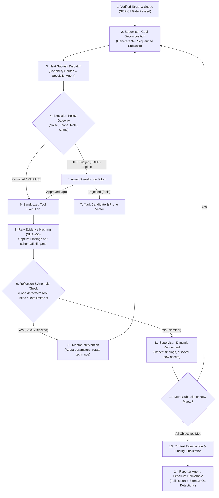

# Dynamic Autonomous Supervision Workflow

**ID**: `dynamic-supervision`  
**Purpose**: Adaptive multi-agent execution cycle with dynamic subtask decomposition, iterative refinement, automated reflection, and context compaction.  
**Governing Agent**: [`agents/supervisor.md`](../agents/supervisor.md)  
**Schema Compliance**: [`schemas/finding.md`](../schemas/finding.md)  

---

## 1. Workflow Architecture

Unlike static, linear penetration testing schedules, the **Dynamic Supervision Workflow** runs an iterative sense-plan-act-reflect feedback loop:



---

## 2. Phase-by-Phase Execution Protocol

### Phase 1: Intake & Initial Graph Generation
1. Receive verified scope from the Intake Gate (`SOP-01`).
2. `supervisor` analyzes the target profile (e.g., domain, IP range, API endpoint, cloud tenant).
3. `supervisor` generates the initial task DAG (Directed Acyclic Graph) of 3 to 7 discrete subtasks.
4. Each subtask is assigned to a designated specialist agent (`recon`, `scanner`, `cloud-security`, etc.).

### Phase 2: Execution Policy Enforcement
Before any specialist agent triggers an external utility (`nmap`, `ffuf`, `sqlmap`, `nuclei`, `curl`):
1. Tool request is submitted to the **Execution Policy Gateway** (`tools/gateway.py`).
2. Target IP/domain is validated against the scope CIDR whitelist.
3. If the tool is classified as active exploitation or `LOUD`, execution pauses and emits an operator approval alert:
   ```text
   ⚠️ [HITL REQUIRED] Tool: nuclei (severity: high) against target: api.internal.corp
   Run: /go [REQUEST_ID] or /hold [REQUEST_ID]
   ```
4. Upon approval, command runs inside an isolated container sandbox.

### Phase 3: Raw Evidence Capture & Finding Ingestion
1. The raw stdout/stderr and network response are captured without truncation.
2. The Gateway computes the SHA-256 digest of the output, assigning an evidence reference tag: `[EVD-XXXXXX]`.
3. Candidate findings are evaluated against the **7-Question Adversarial Gate**:
   - In scope? Reachable? Controllable? Impactful?
4. Validated findings are recorded adhering strictly to `schemas/finding.md`.

### Phase 4: Reflection & Self-Correction
1. After subtask completion, the `supervisor` runs the **Reflection Gate**:
   - Did the tool return empty output or exit code > 0?
   - Did the target return WAF blocks (403 Cloudflare/Akamai/AWS WAF signatures)?
   - Has the agent repeated the same parameter search twice?
2. If an anomaly is identified, the `supervisor` executes a corrective action:
   - Example: Switch from directory wordlist fuzzing to virtual host header inspection.
   - Example: Apply a 2.5-second request throttle to bypass rate limiting.

### Phase 5: Dynamic Subtask Refinement
1. The `supervisor` inspects newly discovered assets and vulnerabilities:
   - *Example*: Recon discovers a `.git/` leak $\implies$ Supervisor immediately injects high-priority subtask: "Extract Git repository and scan for hardcoded credentials (`skills/supply-chain`)".
   - *Example*: Web scan uncovers GraphQL endpoint $\implies$ Supervisor injects `api-security` introspection subtask.
2. Obsolete subtasks are pruned to conserve operator time and runtime resources.

### Phase 6: Context Compaction & Final Reporting
1. As the engagement progresses, historical logs are compressed using the summarization protocol:
   - Tool execution details are condensed into key findings, tested endpoints, and verified evidence hashes.
2. Once all attack chains and verification gates terminate, `reporter` is invoked.
3. Deliverables are compiled:
   - Executive Summary
   - Technical Finding Walkthroughs
   - MITRE ATT&CK & D3FEND cross-mappings
   - Defensive engineering detections (Sigma rules, Sentinel KQL, Splunk SPL).
